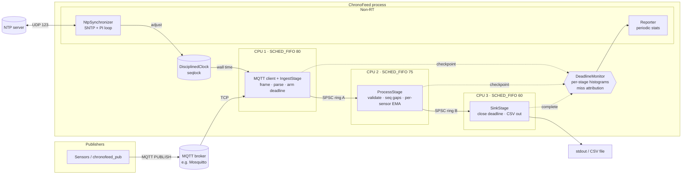

# ChronoFeed

**Deadline-guaranteed sensor ingestion over MQTT.**

ChronoFeed is a multi-threaded C++17 pipeline for Linux (PREEMPT_RT friendly, with a
port layer for POSIX RTOSes). It subscribes to sensor readings over MQTT, stamps each
one against an NTP-disciplined clock, and pushes it through parse, filter and sink
stages under a hard end-to-end deadline (5 ms by default, measured from socket receipt
to sink). Every deadline miss is detected and attributed to the stage where it
happened, and the process exits non-zero if the guarantee was ever broken.

## Features

- **Minimal MQTT 3.1.1 client** written directly on POSIX sockets: CONNECT, SUBSCRIBE,
  PUBLISH (QoS 0/1 receive), keep-alive PINGREQ, reconnect with exponential backoff.
  Zero-copy framing, fixed receive buffer, `TCP_NODELAY`.
- **Stage-per-core pipeline** (`ingest` -> `process` -> `sink`) connected by lock-free,
  cache-line-padded SPSC ring buffers. Samples are fixed-size PODs, so nothing on the
  hot path allocates.
- **Real-time controls:** per-thread CPU affinity, `SCHED_FIFO` priorities, `mlockall`,
  stack prefaulting, and busy-poll or sleep idle strategies. If the process lacks the
  privileges, it logs a warning and keeps running best-effort.
- **Deadline monitor:** each sample carries an absolute monotonic deadline. Every stage
  checks it, records its own latency in a lock-free histogram (p50/p99/p99.9/max), and
  counts misses, drops (ring full), parse errors, out-of-range values and sequence gaps.
- **NTP clock discipline:** an SNTPv4 client feeds a PI loop that steers a software
  clock built on `CLOCK_MONOTONIC`. A clock filter rejects high-delay samples, large
  offsets get stepped, and the integral term learns oscillator drift. The kernel clock
  is never touched, so no root is needed. Readers get the clock parameters from a
  seqlock and never block.
- **Publisher-to-ingest transit latency** is measured once both ends are on disciplined
  time.
- **Load generator** (`chronofeed_pub`) with fixed-rate pacing, CSV or JSON payloads,
  and optional injected sequence gaps.

## Architecture



The deadline window opens at the monotonic timestamp taken right after `recv()` returns
the bytes that carry a message, and it closes when the sink dequeues the sample. Stdio
writes happen after that, behind a 1 MiB buffer that is flushed every 100 ms.

```
rx_mono ─┬─ ingest (parse) ─┬─ ring A wait + process ─┬─ ring B wait ─┬─▶ complete
         │                  │                         │               │
         └──────────────── deadline_mono = rx_mono + budget ──────────┘
```

### Source layout

```
include/chronofeed/
  time.hpp           monotonic/realtime helpers, absolute sleeps
  sample.hpp         fixed-size SensorSample record
  spsc_ring.hpp      lock-free single-producer/single-consumer ring
  config.hpp         typed config + env overrides
  mqtt/packet.hpp    MQTT 3.1.1 codec
  mqtt/client.hpp    blocking subscriber with keepalive/reconnect
  payload.hpp        CSV / flat-JSON payload parser
  rt/thread.hpp      affinity, SCHED_FIFO, mlockall (OS port layer)
  histogram.hpp      lock-free latency histogram
  deadline.hpp       DeadlineMonitor
  clock_source.hpp   wall-clock interface
  ntp/sntp.hpp       SNTPv4 client
  ntp/discipline.hpp DisciplinedClock, PI loop, NtpSynchronizer
  stages.hpp         Ingest/Process/Sink stages
  pipeline.hpp       wiring and thread lifecycle
src/                 implementations + main.cpp
tools/publisher.cpp  load generator
tests/               Google Test suite
config/              default runtime config
deploy/              local Mosquitto broker (docker compose)
```

## Payload formats

```
CSV:   sensor-3,1042,1700000000123456789,21.734
JSON:  {"id":"sensor-3","seq":1042,"ts":1700000000123456789,"value":21.734}
```

`ts` is the publisher's wall clock in nanoseconds since the UNIX epoch. In JSON, `id` is
optional and defaults to the last segment of the topic.

## How to run

### Requirements

- Linux with a C++17 compiler (GCC 9+ or Clang 10+) and CMake 3.16+. It also builds
  on macOS, but CPU pinning is unavailable there.
- An MQTT broker. The repo ships a Mosquitto compose file.
- Optional, for hard real-time behaviour: a PREEMPT_RT kernel, isolated cores
  (`isolcpus=1-3 nohz_full=1-3`), and either `CAP_SYS_NICE` + `CAP_IPC_LOCK` or suitable
  `rtprio`/`memlock` limits in `/etc/security/limits.conf`.
- Outbound UDP/123 to an NTP server, or set `ntp.enabled = false`.

### Build

```bash
cmake -S . -B build -DCMAKE_BUILD_TYPE=Release
cmake --build build -j
```

### Start a broker

```bash
docker compose -f deploy/docker-compose.yml up -d
```

### Configure

Edit `config/chronofeed.conf` (deadline, CPU layout, priorities, NTP server). Credentials
and per-host settings come from environment variables, never from the config file:

```bash
cp .env.example .env      # fill in values
set -a; source .env; set +a
```

### Run the pipeline

```bash
# Grant RT privileges without running as root (once per build):
sudo setcap cap_sys_nice,cap_ipc_lock+ep build/chronofeed

./build/chronofeed -c config/chronofeed.conf > samples.csv
```

In another terminal, generate load:

```bash
# 8 sensors, 5000 msg/s aggregate, 30 s, with a skipped sequence number every 1000 msgs
./build/chronofeed_pub -n 8 -r 5000 -d 30 -g 1000
```

ChronoFeed logs a report to stderr every `pipeline.report_interval_s`. The numbers below only show the format; they are not measured results:

```
report: deadline=5.000ms done=150000 missed=0 (0.0000%) dropped=0 parse_err=0 invalid=0 gaps=150 |
        e2e us p50=20.0 p99=40.0 p99.9=60.0 max=212.4 | ingest p99=10.0us ... | transit p50=0.41ms ...
report: ntp synced=1 offset=+0.042ms delay=11.204ms freq=-12.381ppm ok=9 rej=1 fail=0
```

Stop it with Ctrl-C, or pass `-d <seconds>` to run for a fixed time. Exit codes: `0` means
every sample met its deadline, `3` means at least one miss, `1` means a fatal error.

## How to test

The unit tests use Google Test, which CMake downloads through `FetchContent` on first
configure:

```bash
cmake -S . -B build -DCHRONOFEED_BUILD_TESTS=ON
cmake --build build -j
ctest --test-dir build --output-on-failure
# or run the binary directly
./build/chronofeed_tests
```

What the tests cover:

| Suite | What it checks |
|-------|----------------|
| `SpscRing` | FIFO order, full/empty behaviour, wrap-around, and 500k-item concurrent producer/consumer ordering |
| `Mqtt*` | remaining-length boundaries, CONNECT flags, SUBSCRIBE reserved bits, partial/back-to-back framing, QoS 1 packet ids, CONNACK codes |
| `Payload` | CSV/JSON parsing, key order, topic fallback, malformed and non-finite input, id truncation |
| `LatencyHistogram` | percentile bucket edges, overflow, reset |
| `DeadlineMonitor` | deadline arming, on-deadline vs late samples, per-stage miss attribution, counters |
| `Sntp` / `ClockDiscipline` / `DisciplinedClock` | NTP timestamp conversion, offset/delay math, reply validation (originate echo, KoD, leap), step vs slew, delay-outlier rejection, convergence against a simulated 50 ppm drifting oscillator, seqlock clock adjustment |
| `Config` | defaults, typed parsing, unknown-key rejection, env overrides |
| `ProcessStage` | per-sensor EMA, range validation, sequence-gap counting |

For an end-to-end check, run the broker, `chronofeed -d 30` and `chronofeed_pub -d 25`
together, then confirm the exit code is `0` and the final report shows `missed=0`.
To see the guarantee hold or break under load, add `stress-ng --cpu 4` on the
non-isolated cores.

## Design notes

- **Why a hand-written MQTT client?** Library clients such as Paho run their own network
  threads, allocate per message and take internal locks. Owning the socket loop keeps
  the ingest thread's behaviour predictable and lets the deadline clock start at the
  real `recv()` timestamp.
- **Why not discipline the kernel clock?** `adjtimex` needs root and would fight with
  `chronyd`/`ntpd`. A process-local disciplined clock gives accurate sample timestamps
  without either problem, and deadline arithmetic stays on `CLOCK_MONOTONIC`, which never
  jumps.
- **Load shedding over blocking:** if a downstream ring is full the sample is dropped and
  counted. Back-pressure into the socket would let one slow stage push every later sample
  past its deadline.
- **RTOS portability:** everything platform-specific is in `src/rt/thread.cpp`, plus the
  socket calls. A port to another POSIX RTOS (QNX, NuttX, VxWorks POSIX) mostly means
  swapping the affinity and scheduling calls there.
